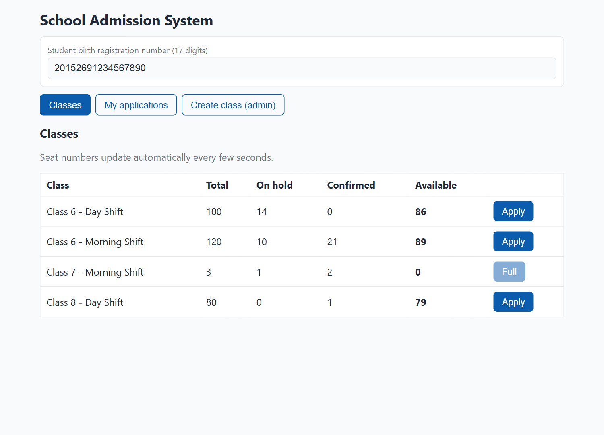
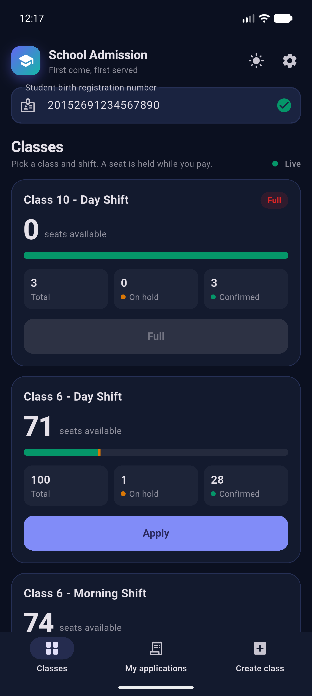
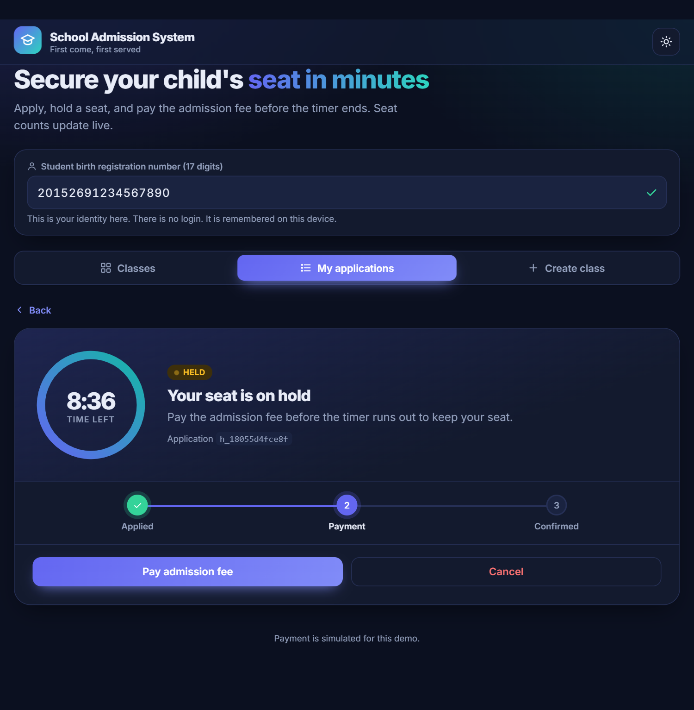
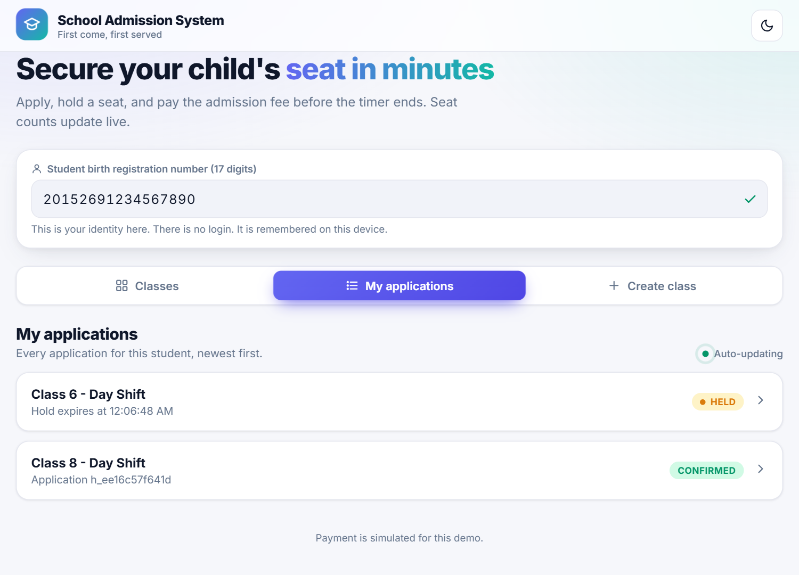
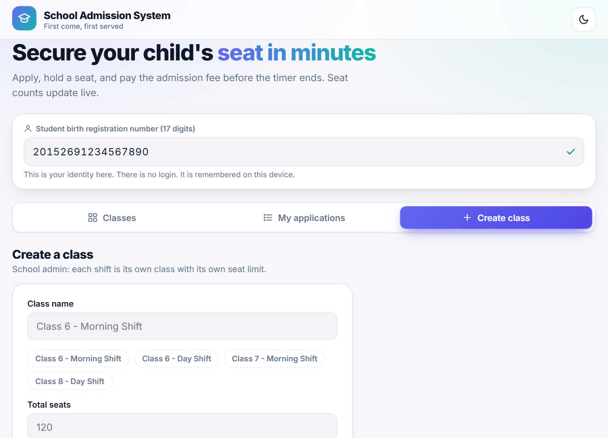
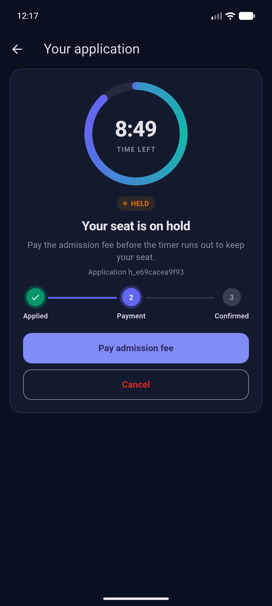
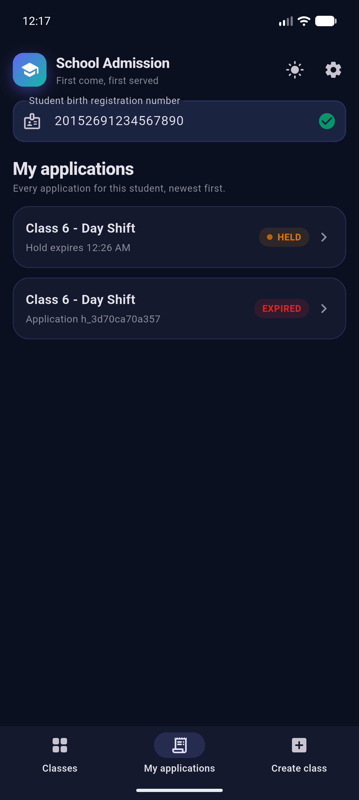
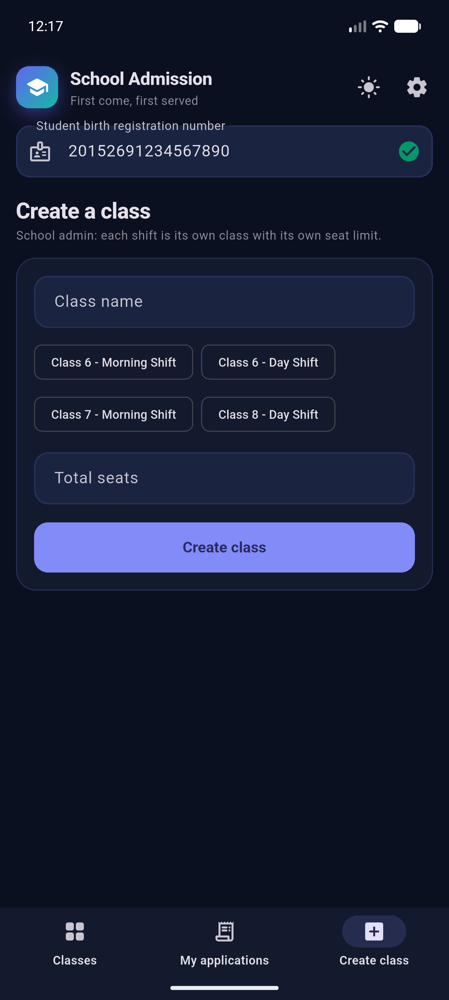
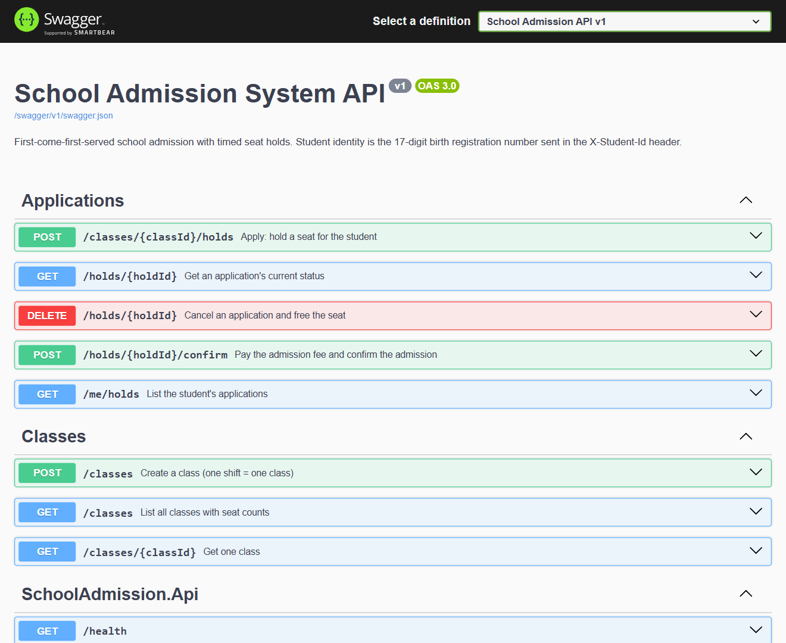
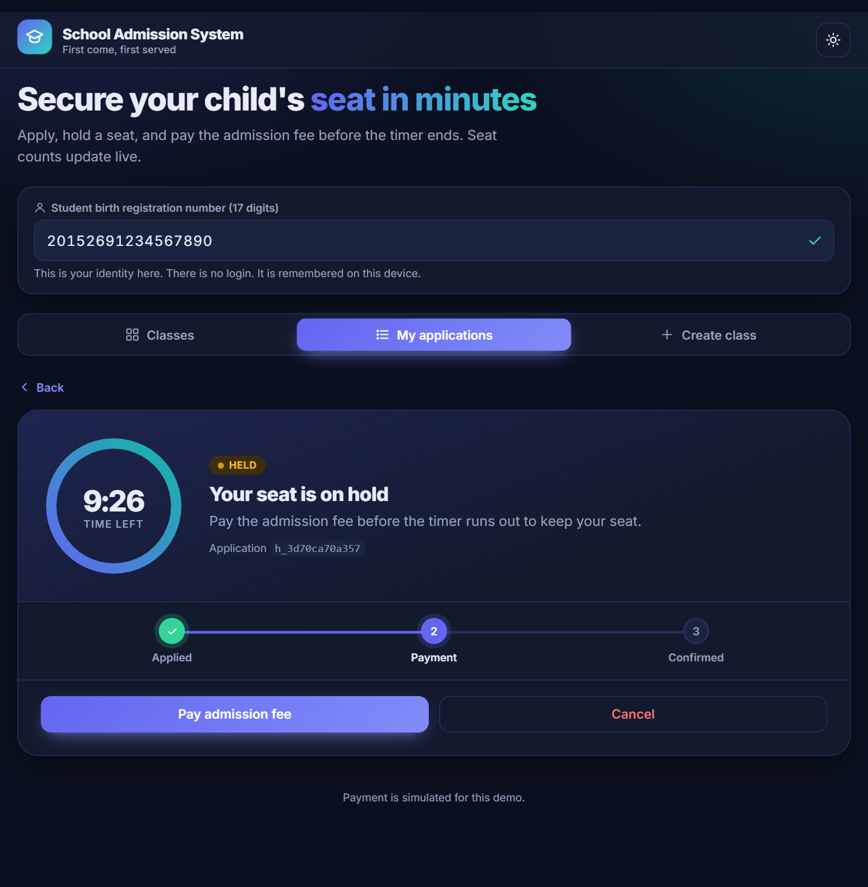

# School Admission System

First-come-first-served online admission for a private school. A student applies, a seat is **held** for a limited time, paying the admission fee **confirms** it, and an unpaid hold **expires** and frees the seat automatically.

**Stack:** .NET 8 (ASP.NET Core minimal API, EF Core) · PostgreSQL · React 19 + TypeScript (Vite) · Docker · Flutter (bonus mobile client)

| Web UI (React) | Mobile app (Flutter) |
|---|---|
|  |  |

<details>
<summary>More screenshots</summary>

**Web**

| Application + countdown | My applications | Create class |
|---|---|---|
|  |  |  |

**Flutter app** (release APK on an Android emulator, running against the live backend)

| Application + countdown | My applications | Create class |
|---|---|---|
|  |  |  |

**API docs (Swagger UI at `/swagger`)**



</details>

## Live demo

| | |
|---|---|
| Web app (Vercel) | https://school-admission-system-ebon.vercel.app |
| API + Swagger (Render) | https://school-admission-system-pzr4.onrender.com/swagger |
| Database | Neon PostgreSQL |

The API runs on a free Render instance, so the first request after a quiet period can take ~50 seconds while it wakes up.



## Run with Docker (the only requirement)

```bash
docker compose up --build
```

| What | URL |
|---|---|
| Web UI | http://localhost:3000 |
| Backend API | http://localhost:8080 |
| **Swagger / API docs** | http://localhost:8080/swagger |
| PostgreSQL | localhost:5432 (`school` / `school_pw`, db `school_admission`) |

Data lives in the named volume `pgdata`, so it survives `docker compose down` and `docker compose up`. (`docker compose down -v` deliberately wipes it.)

### Demo data

```bash
python scripts/seed.py                       # local stack
python scripts/seed.py https://your-backend   # any deployed backend
```

Creates a few classes and fills them with confirmed admissions (safe to re-run).

### Configuration (environment variables)

| Variable | Service | Default | Meaning |
|---|---|---|---|
| `ConnectionStrings__Default` or `DATABASE_URL` | backend | local Postgres | Npgsql connection string **or** a `postgres://` URI (Neon/Render style, SSL is enabled automatically) |
| `HOLD_DURATION_SECONDS` | backend | `600` | How long a seat stays held |
| `PORT` | backend | `8080` | Listen port (Render sets this) |
| `CORS_ORIGINS` | backend | `*` | Comma-separated allowed web origins |
| `API_URL` | frontend container | `http://localhost:8080` | Backend URL the **browser** calls (written to `/config.js` at container start) |
| `VITE_API_URL` | frontend build | — | Same, but baked in at build time (used on Vercel) |

## Features

- Create classes (each shift is its own class with its own seat limit)
- Class list with total / on-hold / confirmed / available seats, auto-refreshing every few seconds
- Apply (hold a seat) → live countdown → **Pay admission fee** (simulated) or **Cancel**
- When time runs out the application flips to `EXPIRED` and Pay is disabled, with no reload
- "My applications" for the student; everything survives a page refresh (student ID and open application are remembered)
- Readable error messages for sold-out, expired, invalid input and server-down cases

Identity is the 17-digit birth registration number typed into the box at the top (sent as the `X-Student-Id` header). There is no login.

## API

Base URL `http://localhost:8080`, JSON everywhere. Full interactive docs: **`/swagger`**.

| # | Method & path | Purpose |
|---|---|---|
| 1 | `POST /classes` | Create a class `{name,totalSeats}` → 201 |
| 2 | `GET /classes` | List classes with `heldSeats`, `confirmedSeats`, `availableSeats` |
| 3 | `GET /classes/{classId}` | One class |
| 4 | `POST /classes/{classId}/holds` | Apply (`X-Student-Id`) → 201, or **409** if no seat |
| 5 | `GET /holds/{holdId}` | Status: `HELD`, `CONFIRMED`, `EXPIRED`, `CANCELLED` |
| 6 | `POST /holds/{holdId}/confirm` | Pay the fee (`X-Student-Id`), idempotent |
| 7 | `DELETE /holds/{holdId}` | Cancel (`X-Student-Id`) → 204 |
| 8 | `GET /me/holds` | The student's applications |

Errors are `{ "error": "human readable message" }` with the status codes described in [ASSUMPTIONS.md](ASSUMPTIONS.md).

## How the seat limit is guaranteed

Seat decisions run inside a Postgres transaction that first takes a row lock on the class (`SELECT … FOR UPDATE`). Concurrent applications for the same class are serialized **by the database**, so `held + confirmed ≤ totalSeats` holds for any number of simultaneous requests, **and across several backend processes** sharing one database. A partial unique index `(class_id, student_id) WHERE status IN ('HELD','CONFIRMED')` backs up the one-active-application-per-class rule. Expiry is enforced by the query predicate (`expires_at <= now`) and a background sweeper that tidies rows. Details in [ASSUMPTIONS.md](ASSUMPTIONS.md).

## Tests

**Backend** (xUnit, real Postgres, in-process API). Start Postgres, then run:

```bash
docker compose up -d postgres
cd backend/tests/SchoolAdmission.Tests
dotnet test
```

Covers: 100 parallel applicants for 10 seats (exactly 10 succeed), idempotent confirm, automatic expiry freeing the seat, duplicate / foreign-hold / validation rules, cancel and re-apply. The tests use their own database (`school_admission_test`); set `TEST_DATABASE_URL` to point elsewhere.

**Two backend processes, one database** (bonus):

```bash
docker compose up -d postgres
bash scripts/two-instance-check.sh
```

Starts two API processes on ports 8081/8082, sends 200 parallel applications split across both, and checks the seat count. Sample result: `10 × 201`, `190 × 409`, `held+confirmed = 10 ≤ totalSeats = 10`.

**Frontend** (Vitest + React Testing Library):

```bash
cd frontend
npm ci
npm test
```

**Flutter**:

```bash
cd mobile
flutter test
```

## Flutter app

Folder `mobile/`. Same four screens as the web UI. The server address can be changed from the gear icon in the app; defaults are `http://10.0.2.2:8080` on an Android emulator and `http://localhost:8080` elsewhere. Override at build time with `--dart-define=API_URL=https://your-backend`.

```bash
cd mobile
flutter run                          # emulator / device / -d chrome
flutter build apk --release --dart-define=API_URL=https://your-backend.example.com
```

## Deployment notes

- **Backend → Render** (Docker web service, root `backend/`): set `DATABASE_URL` (Neon URI), `CORS_ORIGINS` (your Vercel URL), optionally `HOLD_DURATION_SECONDS`. `PORT` is injected by Render. The schema is created on first start.
- **Database → Neon**: use the pooled or direct `postgres://…` connection string as `DATABASE_URL`.
- **Web → Vercel** (root `frontend/`, framework Vite): set `VITE_API_URL` to the Render URL.
- **Android app → GitHub Release**: attach the release APK.

## Repository layout

```
backend/    ASP.NET Core API, Dockerfile, tests (backend/tests)
frontend/   React + TypeScript (Vite), Dockerfile, nginx config
mobile/     Flutter app
scripts/    two-instance concurrency check, screenshot capture
docs/       screenshots
docker-compose.yml   postgres + backend + frontend
ASSUMPTIONS.md · AI_USAGE.md
```

To regenerate the screenshots: `cd scripts/screenshots && npm i && npm run capture` (needs the stack running, the Flutter web build served on :5174, and Chrome).
